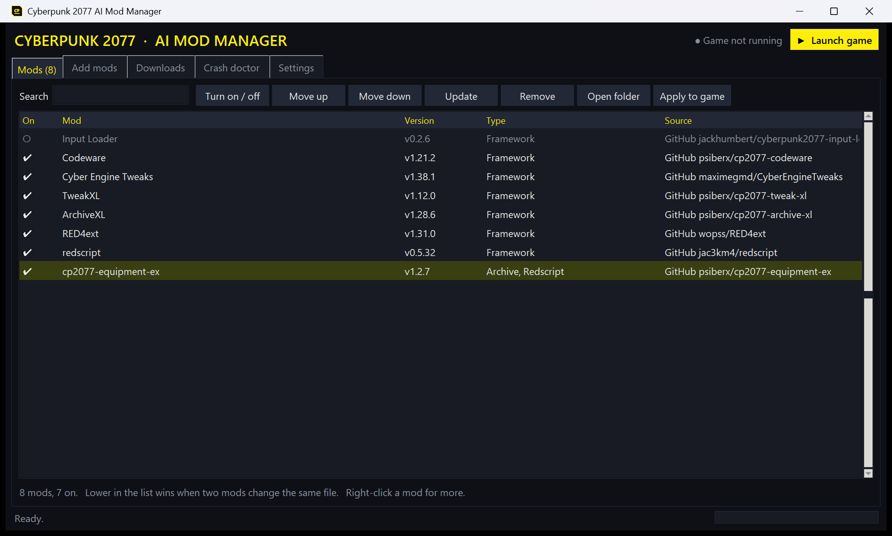

# Cyberpunk 2077 AI Mod Manager

A Windows mod manager for Cyberpunk 2077 that sets your mods up for you and fixes crashes.



## What it does

- **Paste links, get mods.** Paste many links at once: Nexus mod pages, Nexus collections (mod packs), GitHub pages, or direct `.zip` / `.7z` / `.rar` links. Each mod's required mods are added for you.
- **Automatic set-up.** Every archive is unpacked and each file goes to the folder the game loads it from (`archive/pc/mod`, `r6/scripts`, `r6/tweaks`, `red4ext/plugins`, Cyber Engine Tweaks mods, REDmod). FOMOD installers run with their default choices. Missing frameworks are installed by themselves.
- **No-click frameworks.** RED4ext, Cyber Engine Tweaks, redscript, ArchiveXL, TweakXL, Codeware, Input Loader and Mod Settings download from their GitHub releases, with no account.
- **Crash doctor.** The app watches the game. After a crash it reads the exit code, the game's crash dump, Windows crash events and the framework logs (redscript, RED4ext, ArchiveXL, TweakXL, CET) to find the mod that caused it.
  - One possible fix: it is applied automatically (you can turn this off).
  - More than one fix (update, turn off, change the load order): you pick.
  - Every fix can be undone.
  - No clue in the logs: "Find the bad mod for me" turns half of the mods off per game start until the bad one is found.
- **Load order and conflicts.** Mods lower in the list win. Archive conflicts are found by reading the `.archive` file indexes, and you choose which mod wins.
- **Virus scan.** Every download is scanned with Microsoft Defender before it is installed. Turn it off in Settings to go faster with big mod lists.
- **Safe to undo.** Mods stay in their own folder and are copied into the game. Game files that a mod replaces are backed up and put back when the mod is removed.

## Nexus Mods and free accounts

Nexus Mods gives a free account a download only after a person clicks **Slow download** on the website. This app follows the Nexus rules, so with a free account:

1. The app opens the Nexus page of each file in your browser, one at a time.
2. You click **Slow download**.
3. The app downloads, scans, installs and sets up the file, then opens the next page.

With a Nexus Premium account no clicks are needed. Frameworks, GitHub mods and direct links never need a click.

## Install

1. Download `CP2077 AI Mod Manager.exe` from the [Releases](../../releases) page and run it. Python is not needed.
2. In **Settings**:
   - Set the Cyberpunk 2077 folder (**Find it for me** looks in Steam, GOG and Epic).
   - Paste your Nexus API key (**Get my key** opens the page; free accounts have one too).
   - Click **Use this app for Nexus downloads** so the download buttons on Nexus send files to the app.
3. In **Add mods**, paste your links and click **Download and set up everything**.
4. Click **Launch game**.

Requirements: Windows 10 or 11 (the app uses the built-in `tar.exe` and Microsoft Defender).

### Run from source

```
python app.py
```

Python 3.12 or newer, standard library only.

## Where your data is

Mods, downloads, backups and settings (including your Nexus API key) are kept in `%LOCALAPPDATA%\CP2077ModManager` on your PC. The key is sent only to `api.nexusmods.com`.

## Development

```
python -m unittest discover -s tests -t .     # unit tests
python -u tests/e2e_crash.py                  # real-crash end-to-end check (about 1 minute)
```

Build the exe:

```
python -m PyInstaller --noconfirm --clean --windowed --onefile --name "CP2077 AI Mod Manager" --icon manager_ui/icon.ico --add-data "manager_ui/icon.png;manager_ui" --paths . app.py
```

## Disclaimer

This is a fan project. It is not made by or affiliated with CD PROJEKT RED or Nexus Mods. Cyberpunk 2077 is a trademark of CD PROJEKT S.A.

Author: [RyanWeera](https://github.com/RyanWeera)
