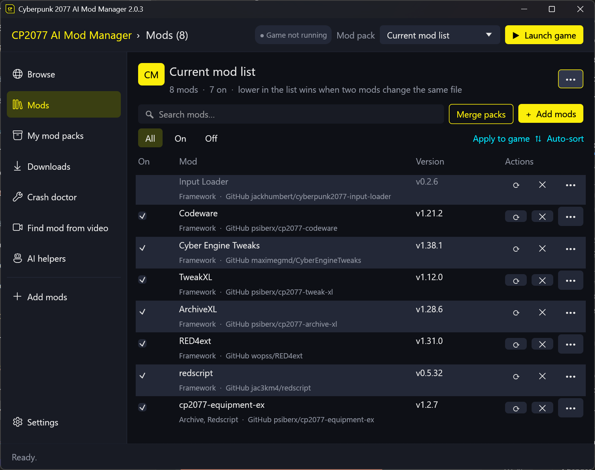

# Cyberpunk 2077 AI Mod Manager

A Windows mod manager for Cyberpunk 2077 that sets your mods up for you and fixes crashes.

<p align="center">
  <a href="https://github.com/RyanWeera/cyberpunk-ai-mod-manager/releases/download/v2.0.0-manual/CP2077.AI.Mod.Manager.exe"></a>
</p>
<p align="center">
  <a href="https://github.com/RyanWeera/cyberpunk-ai-mod-manager/releases/tag/v2.0.0-manual"></a>
  
  
</p>

**One file. No installer. No Python.** Windows 11 (Windows 10 works for most mods). The button gives you the manual-click version; its **Update** button keeps it up to date.

**New in 2.0:** the whole app is rebuilt in Rust, with a new window in the Cyberpunk, Arasaka and Militech styles.
It keeps every feature, your mods and your settings. This is the manual-click version: with a free Nexus
account, you click **Slow download** on each file's Nexus page, and the app does the rest. The app always adds
the Advanced Crash Reporter mod, so a crash report names the mod that caused it. The **Update** button of version 1.x installs the
automatic-click build, so 1.x users download this version with the button above instead.



## Get started in 3 steps

1. **Download and open it.** Click the yellow button above, then double-click `CP2077.AI.Mod.Manager.exe`. You can keep it anywhere, for example on your Desktop.
   - If Windows shows "Windows protected your PC", click **More info**, then **Run anyway**. Windows shows this for new apps that are not code-signed yet.
2. **Set it up once (Settings tab).**
   - Click **Find it for me** to find your Cyberpunk 2077 folder (Steam, GOG or Epic).
   - Click **Get my key**, copy your personal API key from Nexus, and paste it. Free accounts have one too.
   - Click **Use this app for Nexus downloads**, so the download buttons on Nexus send files to the app.
3. **Add mods and play.** In **Add mods**, paste mod links or a collection link and click **Download and set up everything**. When the **Downloads** tab is finished, click **Launch game**. With a free Nexus account you click **Slow download** once for each file (see [below](#nexus-mods-and-free-accounts)).

The yellow banner at the top of the app shows which set-up steps are still missing.

## What it does

- **Browse Nexus Mods in the app.** The **Browse** page (the globe in the bar on the left) lists Cyberpunk 2077 mods with their pictures, downloads and endorsements. Search by name, filter by category, sort them, and click **Install**. The app downloads the mod and the mods it needs. Mods you already have show **Installed**. Switch to **Mod packs** at the top to browse Nexus collections the same way: **Install** downloads every mod in the pack and saves the pack. If the pack has optional mods, the app first asks which ones you want.
- **A warning for mods that may not work any more.** Before the app downloads a mod, it checks whether the author removed or hid it, whether its name says it is outdated or broken, and whether it was last updated before game update 2.0. If so, you pick **Download** or **Skip**. In a mod pack, these mods are in the same list as the optional mods, and you untick the ones to skip.
- **My mod packs.** The **My mod packs** page (the box icon in the bar on the left) shows each mod pack you installed from Nexus and each pack you saved or merged. Search them, filter by **From Nexus** or **My own**, see the mods in a pack and which ones are not installed yet, and click **Use**, **Launch** or **Delete**. When a pack has mods that are not installed yet, click **Complete installation** to download and install them (the exact files the pack lists, with no outdated-mod question). When the last download ends, the app uses the pack by itself: its mods go on in its order, the others go off, and the game folder is set up.
- **Compatibility patches, found for you.** When you add a Nexus mod, the app looks on Nexus for patches that make it work with a mod you already have, and adds them. Mods that come from a mod pack skip this, because the pack brings its own patches.
- **Easy mod list.** The **Mods** page shows each mod with an on/off switch, its version, and buttons to update or remove it. **Add mods** (top right) opens one list of all the ways to add mods, and **Merge packs** is next to it.
- **Paste links, get mods.** Paste many links at once: Nexus mod pages, Nexus collections (mod packs), GitHub pages, or direct `.zip` / `.7z` / `.rar` links. Each mod's required mods are added for you.
- **Find mod from video.** Paste a YouTube, TikTok, Instagram or other video link. The app reads the video's description or caption and lists the mods it links or names, and you add them with one click. YouTube works best, because its descriptions have the mod links. The app does not watch the video, so a mod that is only shown on screen is not found.
- **Automatic set-up.** Every archive is unpacked and each file goes to the folder the game loads it from (`archive/pc/mod`, `r6/scripts`, `r6/tweaks`, `red4ext/plugins`, Cyber Engine Tweaks mods, REDmod). FOMOD installers run with their default choices. Missing frameworks are installed by themselves.
- **No-click frameworks.** RED4ext, Cyber Engine Tweaks, redscript, ArchiveXL, TweakXL, Codeware, Input Loader and Mod Settings download from their GitHub releases, with no account.
- **Crash doctor.** The app watches the game. After a crash it reads the exit code, the game's crash dump, Windows crash events and the framework logs (redscript, RED4ext, ArchiveXL, TweakXL, CET) to find the mod that caused it. It also lists the mods found on the crashing thread's call path, explains the Windows error code in plain words, and reads the report of the [Advanced Crash Reporter](https://www.nexusmods.com/cyberpunk2077/mods/34403) mod. The app adds that mod by itself when your Nexus key is set and before each launch; a crash report is ready from the next game start.
- **Freezes.** When the game stops responding for about 25 seconds (20 seconds after Windows shows "Not responding"), the app takes a snapshot of every game thread. If the game never comes back, the Crash doctor names the mod code found on the game's main thread (the first thread in the snapshot).
- **More crash clues.** The Crash doctor also shows where in a DLL mod the crash happened (and the function name when the mod ships its `.pdb` file), DLL mods that take more than 3 seconds to load, mods you installed by hand that changed in the last 7 days, and a game update since the last launch that worked (frameworks often need an update after a patch).
- **Crash report.** **Save crash report** (Crash doctor tab) writes one text file about the last crash or freeze and your mods, to share with a mod author. Folder paths of your PC are hidden in it. **Copy for an AI** puts the same report on your clipboard as a question for an AI chat. After each crash the app keeps a zip of the crash report and the mod logs (the game deletes old logs); **Open saved crash logs** shows them.
  - One possible fix: it is applied automatically (you can turn this off).
  - More than one fix (update, turn off, change the load order): you pick.
  - Every fix can be undone.
  - No clue in the logs: "Find the bad mod for me" turns half of the mods off per game start until the bad one is found. A mod goes off together with the mods that need it, so the game still starts. A launch that ends sooner than the crash came before does not count.
  - No clue in the logs and no Advanced Crash Reporter yet (for example, no Nexus key): the app offers to install it.
  - Each crash gets an ID (the module and place it crashed in), so you can see when the same crash comes back.
  - A mod that also logs errors in launches without a crash is not blamed for the crash.
- **Styles.** Pick Cyberpunk (yellow), Arasaka (red) or Militech (amber) in the Settings tab. The window changes at once.
- **Updates.** Click **Update** in the Settings tab. When GitHub has a newer manual-click release (a tag that ends in `-manual`), the app asks first. It then downloads that release's exe and scans it with Microsoft Defender (if Defender finds a threat or cannot scan it, nothing changes). Then it closes, swaps the exe and opens again.
- **Mod profiles (mod packs).** Keep different sets of mods for different play-throughs. In the Mods page, turn on the mods you want, open the **•••** menu at the top right and pick **Save this list as a pack…**: the pack keeps which mods are on and their order. Pick a pack next to **Launch game** to play with it, or pick **Use the picked pack** in the same menu to set the list to it and apply it to the game now. A pack turns off the mods it does not list, but a framework that is on stays on. Each Nexus collection you add is a pack too, and **Merge packs** makes one pack from several. Mods stay installed when you switch, so switching is fast.
- **Load order and conflicts.** Mods lower in the list win. Archive conflicts are found by reading the `.archive` file indexes, and you choose which mod wins. **Auto-sort** (Mods tab) sorts the list for you: frameworks first, each mod below the mods it needs, and a small patch below the big mod it changes. You can undo it in the Crash doctor tab.
- **Use Claude or another AI app.** Give a mod link or a video link to Claude and ask it to set the mods up. The app is an MCP server: Claude Desktop, Claude Code, Cursor and other MCP apps can add Nexus Mods mods and collections and the core frameworks, sort the load order and check for problems through the app's window. Other GitHub links and direct download links you paste yourself. The **AI helpers** tab copies the setup for you. With a free Nexus account the **Slow download** rules [below](#nexus-mods-and-free-accounts) apply.
- **Local AI.** The app comes with a free AI model (Qwen3.5 2B, Apache 2.0 license, tuned to debug Cyberpunk 2077 mods: see `local_ai/MODEL.md`) and the [llama.cpp](https://github.com/ggml-org/llama.cpp) engine (MIT license) in its `local_ai` folder: no install, no account, offline. It runs only while the app is open and the game is not running, so the game gets your whole PC. **Ask the local AI** (Crash doctor tab) lets it read your mods and problems, pick fixes and find patches that must load after the mod they change. In the **AI helpers** tab you can describe a bug in your own words: the AI tells you why it happens and offers fixes. You see each change first, and you can undo it.
- **Virus scan.** Every download is scanned with Microsoft Defender before it is installed. Turn it off in Settings to go faster with big mod lists.
- **Safe to undo.** Mods stay in their own folder and are copied into the game. Game files that a mod replaces are backed up and put back when the mod is removed.

## Nexus Mods and free accounts

Nexus Mods gives a free account a download only after a person clicks **Slow download** on the website. The Nexus terms do not allow a program to click it, so in this version you click it yourself:

1. For each file, the app opens the file's Nexus page in your normal browser, one at a time.
2. You click **Slow download**. Nexus sends the download link to the app.
3. The app downloads, scans, installs and sets up the file, then opens the page of the next one.

A Nexus Premium account needs no clicks.

The download bar shows how many clicks are left. If **Slow download** does nothing, another app (such as Vortex) gets the Nexus links: open **Settings** and click **Fix it: use this app** in the **Download button** row. That row names the app that gets the links now.

With a Nexus Premium account no clicks are needed. Frameworks, GitHub mods and direct links never need a click. If a Nexus mod's page links a GitHub repo whose name matches the mod, and its latest release has the same version and one Windows archive, the app downloads that copy with no click. The app finds that repo from the mod's description only; it does not check that the Nexus author owns it.

If you click a "Mod Manager Download" button on Nexus yourself (not on a page the app opened), the app shows the mod's name and asks you before it installs anything. Any web page can send such a link, so this check keeps pages from installing mods without you.

## Download, check and remove

- **Every version:** the [Releases](../../releases) page.
- **Check the file (optional):** each release lists the exe's SHA-256. In PowerShell, run `Get-FileHash .\CP2077.AI.Mod.Manager.exe` and compare.
- **Update:** click **Update** in the Settings tab (from v2.0.0-manual on). Or close the app and replace the exe with the newest manual-click exe from the [Releases](../../releases) page (its tag ends in `-manual`). Your mods and settings stay. If the new exe is in a different folder or has a different name, click **Fix it: use this app** in the Settings tab, and copy the AI app setup again (**AI helpers** tab). The version is shown in the title bar.
- **Remove:**
  1. In the **Mods** tab, clear the **Search** box, click any mod, press **Ctrl+A**, then click **Turn on / off** until every row shows ○. This takes the mods' files out of the game folder and puts back the game files (and your own `modlist.txt`) that they replaced.
  2. Wait until the status bar says the mods are set up in the game folder, then close the app.
  3. Delete the app's folder (the exe and its `local_ai` folder) and the `%LOCALAPPDATA%\CP2077ModManager` folder.
  4. Nexus download buttons still point to the deleted app. If you use another mod manager (Vortex, Mod Organizer 2), set it up for Nexus downloads again. If not, run `reg delete HKCU\Software\Classes\nxm /f` in a Command Prompt.
  5. If you set up an AI app, remove `cp2077-ai-mod-manager` from it. In Claude Code, run `claude mcp remove --scope user cp2077-ai-mod-manager`. In Claude Desktop, delete its entry in **Settings > Developer > Edit Config**.

Requirements: Windows 11, or Windows 10 (the app uses the built-in `tar.exe` and Microsoft Defender). The `tar.exe` in Windows 10 is older and cannot unpack some `.7z` and `.rar` mods; the app then says so.

### Run from source

```
cd rust-app
cargo run --release -p manager_ui
```

Version 2.0 and later are written in Rust (`rust-app/`). The 1.x Python version is still in the repository root
(`python app.py`, Python 3.12 or newer, standard library only). Both versions use the same data folder.

## Where your data is

Mods, backups and settings (including your Nexus API key) are kept in `%LOCALAPPDATA%\CP2077ModManager` on your PC. Downloaded archives are deleted after the install. The key is sent only to `api.nexusmods.com`.

## Development

In `rust-app/`:

```
cargo test --workspace                                     # unit tests
cargo clippy --workspace --all-targets -- -D warnings      # lint
cargo build -p manager_ui --example fake_game             # needed by the next line
cargo test -p manager_ui --test e2e_crash -- --ignored     # real-crash end-to-end check (about 1 minute)
cargo test -p downloads --test real_browser -- --ignored   # real hidden-browser Slow download click
```

Build the exe with the GNU toolchain (`rustup default stable-x86_64-pc-windows-gnu`) and MinGW `windres` on PATH, so the exe gets its icon and version. Cargo writes `target\release\cp2077-ai-mod-manager.exe`; rename it to `CP2077 AI Mod Manager.exe`.

```
cargo build --release -p manager_ui
```

`rust-app/DIFFERENCES.md` lists where the Rust version behaves differently from the Python version. The local AI benchmark runs with Python: `python -u tests/ai_bench.py practice` (about 1 minute).

Then put the exe and the local AI into one zip (PowerShell). The first line downloads the engine and the model into `local_ai` if they are not there yet (about 1.3 GB, SHA-256 checked):

```
python -c "from local_ai import llm; llm.fetch(lambda what, done, total: None)"
New-Item -ItemType Directory release\local_ai -Force
Copy-Item "rust-app\target\release\cp2077-ai-mod-manager.exe" "release\CP2077 AI Mod Manager.exe"
Copy-Item -Recurse local_ai\engine, local_ai\model, local_ai\MODEL.md release\local_ai\
Compress-Archive release\* CP2077.AI.Mod.Manager.zip -Force
```

## Disclaimer

This is a fan project. It is not made by or affiliated with CD PROJEKT RED or Nexus Mods. Cyberpunk 2077 is a trademark of CD PROJEKT S.A.

Author: [RyanWeera](https://github.com/RyanWeera)
